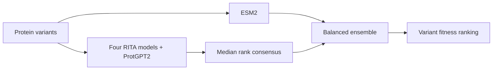

# The Mountain

**Protein variant prediction with a smarter consensus.**

The Mountain predicts the effects of protein insertions and deletions by combining protein models into a balanced ensemble. Feed it a CSV of variants; get a fitness ranking for each protein.

On the **66-assay ProteinGym DMS-Indels benchmark**, the full ensemble reaches **0.558 Spearman**, compared with **0.517 for PoET**. A smaller, standalone configuration runs six models directly from sequences.

## Results

| Model | Spearman ↑ | Configuration |
|---|---:|---|
| **The Mountain · full ensemble** | **0.558** | 23 published predictors + ESM2 |
| **The Mountain · sequence predictor** | **0.541** | Four RITA models + ProtGPT2 + ESM2 |
| PoET | 0.517 | Reference baseline |

These are historical-input results on the frozen ProteinGym v1.3 benchmark, checked with its unmodified official evaluator. A fresh six-model benchmark run remains to be verified. [Results and evidence →](docs/REPRODUCIBILITY.md#verified-historical-input-results)

## From sequences to predictions

Python 3.10–3.13. CUDA, Apple Silicon, and CPU supported.

```bash
git clone https://github.com/islamborghini/the-mountain.git
cd the-mountain
python -m venv .venv
source .venv/bin/activate
python -m pip install '.[inference]'

mountain-predict --sequences examples/sequences.csv --output predictions.csv
```

The command runs all six models and writes a prediction for every variant, plus a provenance manifest. Checkpoints download on first use and load one at a time. A GPU is recommended for larger jobs.

To score your own variants, supply three columns:

```csv
protein_id,variant_id,mutated_sequence
DN7A_SACS2,variant1,ATVKFKYKGEEKQVDISKIKKVWRVGKMISFTYDEGGGKTGRGAVSEKDAPKELLQ
DN7A_SACS2,variant2,GTVKFKYKGEEKQVDISKIKKVWRVGKMISFTYDEGGGKTGRGAVSEKDAPKELLQ
```

```bash
mountain-predict --sequences your_variants.csv --output predictions.csv
```

**Higher `mountain_score` means higher predicted fitness within that protein's variant group.** Scores are relative to the variants supplied together. [Input format, devices, and sequence lengths →](docs/REPRODUCIBILITY.md#predict-new-sequences)

Already have component-model scores? Use `--signals` instead:

```bash
mountain-predict --signals examples/signals.csv --output predictions.csv
```

This also supports the original 24-signal ensemble when its component scores are supplied. [Score inputs and Python API →](docs/REPRODUCIBILITY.md#predict-from-existing-component-scores)

## Why the ensemble works

Related models often carry overlapping evidence. The Mountain turns their ranks into **one robust consensus vote**, then gives **ESM2 an equal vote**. A geometric mean balances the two, and an agreement factor gently discounts conflicting predictions.



That balance is the key result: removing the separation between signal families drops the full ensemble's historical benchmark score from **0.558 to 0.517**.

The combiner is a fixed rule:

```text
score = sqrt(consensus_rank × esm2_rank) / (1 + variance_of_model_ranks)
```

## Built to run and reproduce

- **Standalone inference:** new sequences go directly through the six-model predictor.
- **Stable rankings:** tied inputs receive equal votes, independent of CSV row order.
- **Resumable scoring:** cached features are bound to the exact inputs, checkpoint revisions, and scoring settings.
- **Auditable results:** predictions, input hashes, configurations, and benchmark reports are saved alongside each run.

The full ensemble's improvement over PoET has a protein-cluster bootstrap interval of **+0.0196 to +0.0754**. The six-model interval includes zero; its higher point estimate is reported separately. [Validation reports](validation/) include both profiles and the official evaluator checks.

For benchmark reproduction, native component generation, evaluation, and tests, see the [reproducibility guide](docs/REPRODUCIBILITY.md). The full 24-signal ensemble uses supplied component scores; its result and the six-model predictor's result are distinct.

---

[ProteinGym](https://github.com/OATML-Markslab/ProteinGym) · [Example sequences](examples/sequences.csv) · [Example scores](examples/signals.csv) · [MIT license](LICENSE)
